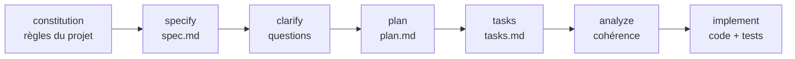

### Le workflow spec-kit

Le projet démarre de zéro avec le workflow [spec-kit](https://github.com/github/spec-kit) de GitHub. L’idée : au lieu de décrire la fonctionnalité en prose libre, on la fait préciser, planifier et découper en tâches par l’agent, qui produit des artefacts versionnés dans `specs/` :



Code: le pipeline spec-kit suivi pour chaque feature (constitution, specify, clarify, plan, tasks, analyze, implement).

### Le bootstrap : premier contact mitigé

Le premier livrable (`specs/001-project-bootstrap/`) est le bootstrap : un backend Maven/Quarkus et un frontend Vite/Vue. Premier constat mitigé : le temps passé à relire les spécifications paraît long, et le concept des *user stories* paraît étrange pour bootstrapper une application. La spec démarre ainsi :

> As a developer, I want to compile, test, and package the backend from a single standard command inside `backend/`, so that a fresh checkout produces a runnable artifact with no manual steps.

Le plan conclut sobrement :

> No game logic yet — scaffolding only.

Et dans les tâches, le test-first est poussé à la lettre — le test du endpoint est écrit pour échouer avant l’implémentation :

> T010 [US1] Contract test for `GET /api/health` per `contracts/health-api.yaml` … run `./mvnw test` — MUST FAIL (endpoint not implemented)

puis :

> T011 [US1] Implement smoke endpoint `GET /api/health` returning `{"status":"UP"}`

Au final, pour prouver que tout marche, le bootstrap ne produit qu’un endpoint de healthcheck : `GET /api/health` → `{"status":"UP"}`. Faire rédiger quatre *user stories* pour arriver à un healthcheck est un détour surprenant — mais rassurant, parce que la pipeline est verte de bout en bout.

Les noms des flux (`specify`, `plan`, `tasks`, `implement`) paraissent aussi verbeux, mais on ne bootstrappe qu’une fois par projet.

### La première vraie feature : le moteur du jeu

Pour la première vraie feature — le moteur du jeu de Cornucopia (`specs/002-cornucopia-game-flow/`) — les flux deviennent nettement plus logiques. Cette fois, la spec raconte une histoire :

> En tant que participant (agent IA), je veux que le maître du jeu (le programme) me demande, à mon tour, ma carte, mon scénario et mon explication, puis recueille un par un les précisions et questions des autres joueurs, et enfin leur vote de validation, en persistants chaque manche dans un fichier JSON sur le disque.

Avec même des archétypes de joueurs « bêtes » pour tester le flux sans dépendre d’un vrai modèle :

> quatre archétypes d’agents « bêtes » (Grumpy, Happy, Greedy, Prof) aux comportements déterministes

Pas de grosse erreur dans la génération des artefacts, du moins à première vue — le bémol étant qu’ils sont verbeux, et que tout relire est encore plus fastidieux que de relire du code.

### Vibecoder : permissions et revue dans l’IDE

Côté exécution, l’implémentation se passe bien. Le vrai point de friction, ce sont les **demandes de permission** : chaque commande, chaque URL demande une validation. C’est cohérent avec ce que je vis au boulot (GitHub Copilot pose le même genre de questions, mais sans flux spec-kit derrière), mais pour un projet jouet, ça casse les pieds — on passe son temps à valider des `./mvnw test`.

Là où **JetBrains Air** change la donne, c’est qu’il permet de lancer **plusieurs agents en parallèle dans l’interface complète de l’IDE**, et surtout de faire de la **revue du code des agents de manière poussée et bien intégrée** — une fonctionnalité que je n’avais jamais pu réellement exploiter avant. Le mécanisme tient en un commentaire posé sur le code généré, suivi de « finish & attach comment » : l’agent reprend la main avec le commentaire attaché.

Deux tics du code généré par Mistral méritent d’être relevés. D’abord une propension à utiliser le pattern « une interface, puis une multitude de records qui l’implémentent » — parfois justifié, parfois non :

```java
public sealed interface Answer {
    record Knows(String answer) implements Answer {}
    record DoesNotKnow() implements Answer {}
}
```

Code: `Answer.java` — la *sealed interface* se défend ici (deux cas, un payload sur l’un d’eux), mais le modèle la ressort un peu systématiquement. Un commentaire dans la revue suffit à le faire corriger.

Ensuite, plus amusant : **Mistral code en français quand on lui donne des specs en français**. La spec 002 étant en français, le code suit :

```java
public class AtelierStore {
    // ...
    public String newAtelierId() {
        return "atelier" + LocalDateTime.now().format(ID_FORMAT);
    }

    public void saveAtelier(String atelierId, Atelier atelier) {
        writeJson(rootDir.resolve(atelierId).resolve("atelier.json"), atelier);
    }
}
```

Code: extrait d’`AtelierStore.java` — `Atelier`, `saveAtelier`, `newAtelierId` : du Java en français. Ça compile, ça marche, et ça m’a arraché un sourire.

*[MVP]: Minimum Viable Product (produit minimum viable)*
*[TDD]: Test-Driven Development (développement piloté par les tests)*
