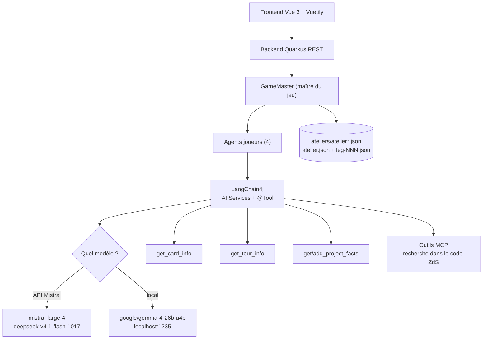
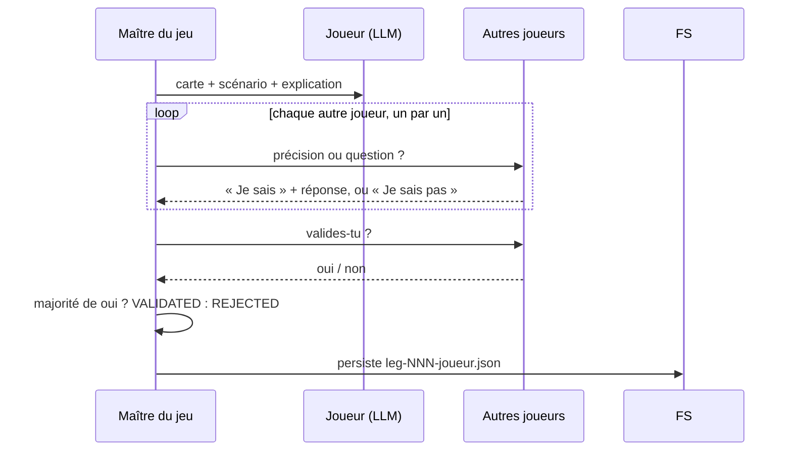

### Le cas d’étude

Le dernier run complet — [`backend/ateliers/atelier20261113-112328/`](../../backend/ateliers/atelier20261113-112328/) — porte sur une vraie feature de Zeste de Savoir : **« Supprimer les requêtes de mises en une pour les sujets déplacés dans la corbeille »** (le lien « Proposer la mise en une » ne devrait pas exister dans un forum privé, et les requêtes existantes devraient être purgées quand un sujet y est déplacé).

Configuration de la partie : 4 joueurs, familles `webapp:VE` et `webapp:AZ` (26 cartes, toutes jouées), langue français. Les agents : trois via l’**API Mistral** (`mistral-large-4` avec deux personnalités — « user edge case » et « curiosity » — plus `deepseek-v4-1-flash-1017`), et un en **local** (`google/gemma-4-26b-a4b` sur `http://localhost:1235/v1`). Cette partie complète a coûté **l’équivalent d’environ 4 € d’API chez Mistral** — inclus dans mon abonnement Pro.

### Déroulement

La partie a duré environ **1 h 40** (10:23 → 12:03), en 7 tours, avec le score final {Joueur-1: 7, Joueur-2: 6, Joueur-3: 3, Joueur-4: 3} — victoire de Joueur-1. Sur les 26 manches jouées : **23 `VALIDATED`, 3 `REJECTED`**, avec 58 précisions et 1 question échangées.

### L’architecture en jeu

Code: l’architecture de CornucopAI et la boucle de persistance d’une partie.

La boucle d’un tour, côté maître du jeu :

Code: la boucle de tour orchestrée par le maître du jeu.

### Des agents outillés : la mémoire partagée et la recherche dans le code

Ce run se distingue des précédents par l’outillage des agents. À côté des outils `@Tool` de LangChain4j (`get_card_info`, `get_tour_info`, et la mémoire partagée `get_project_facts` / `add_project_facts`), les agents disposent d’**outils MCP pour chercher dans le code de ZdS** — ce qui change complètement la qualité des échanges. Les « faits projet » enregistrés dans [`atelier.json`](../../backend/ateliers/atelier20261113-112328/atelier.json) sont typiquement :

> Vérifié dans le code pour le tour VE2 : (1) FeaturedRequestedUpdate (zds/featured/views.py L263-289) hérite seulement de UpdateView, SANS LoginRequiredMixin/PermissionRequiredMixin (contrairement à FeaturedViewMixin L22-24) et est exposé publiquement via path("unes/requete/<int:pk>/", ...) (zds/featured/urls.py L24) — un POST anonyme avec operation=REJECT/REJECT_FOR_GOOD/CONSIDER modifie l’objet (views.py L270-286), et get_object() sur un pk inexistant lève Http404 vs 200/302 si existant : oracle d’énumération des pk de FeaturedRequested bien réel.

Autrement dit : la partie a fait émerger un **vrai point de sécurité** sur ZdS (une vue de mise à jour de requête de mise en une exposée sans contrôle d’accès, avec un oracle d’énumération), vérifié fichier par ligne par les agents eux-mêmes.

### Exemples tirés de l’atelier

**Une carte validée qui confirme le « théâtre » du premier test.** La manche 1 (`leg-001-joueur-1.json`, carte `VE6`, `VALIDATED`) décrit exactement le mécanisme reproché dans le premier test : la règle « forum privé ⇒ pas de mise en une » n’est implémentée que comme une validation d’affichage (cacher le lien), pas comme une validation d’entrée — `featured_request_allowed()` ne teste que `not topic.is_locked` (zds/forum/views.py L182-183), jamais le caractère privé du forum. C’est dit noir sur blanc dans l’explication de la carte.

**Des cartes rejetées avec des justifications appuyées sur le code.** La manche 17 (`leg-017-joueur-4.json`, carte `AZ4`, `REJECTED`) propose un scénario de fail-open sur un état transitoire « forum null » lors du déplacement d’un sujet. Le vote « non » est justifié point par point, citations à l’appui :

> Le scénario AZ4 repose sur trois mécanismes tous réfutés par le code réel. (1) « État transitoire avec forum null » : Topic.forum est défini zds/forum/models.py L191 comme `forum = models.ForeignKey(Forum, ..., on_delete=models.CASCADE)` — aucun null=True, colonne NOT NULL en base, et perform_move (zds/forum/commons.py L66-80) fait `self.object.forum = forum; self.object.save()` en une seule opération atomique […]. (2) featured_request_allowed() pour les sujets est zds/forum/views.py L182-183 `return not self.object.is_locked` — il n’accède jamais à .forum ni à .groups […]

Même mécanisme pour la question posée en manche 19, sur une hypothétique migration de purge : la réponse de l’agent cite le contenu réel de `zds/featured/migrations/` (0001 à 0008, aucun `RunPython` de filtrage).

Quand les agents ont accès au code, le vote de validation devient un vrai contrôle : les scénarios non applicables sont rejetés avec des arguments vérifiables, au lieu d’être validés avec aplomb.

*[ORM]: Object-Relational Mapping (mapping objet-relationnel)*
